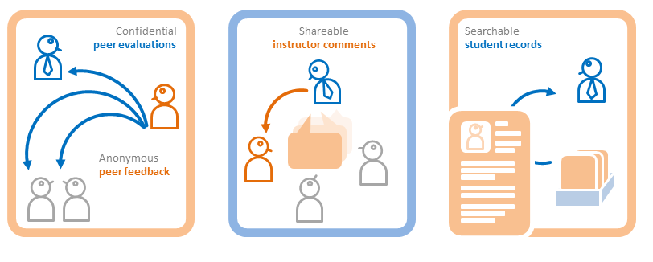

# Trabajo académico: testing de TEAMMATES — equipo Grillos

Repositorio utilizado por el equipo Grillos para un trabajo académico centrado principalmente en **pruebas de software** sobre TEAMMATES.

**TEAMMATES es el proyecto open source original**, desarrollado por sus propios autores. Nuestra participación se presenta como trabajo de testing y preparación del entorno de evaluación; no como creación de toda la plataforma ni de todas las pruebas heredadas.

## Capacidades que muestra este trabajo

- Comprensión y preparación del entorno de un proyecto existente.
- Trabajo con una aplicación que combina Java, Angular y Gradle.
- Ejecución y revisión de pruebas y de sus resultados en el contexto académico.
- Lectura de reportes y documentación de calidad de software.

El detalle de tipos de prueba ejecutados por cada integrante, fechas y resultados debe respaldarse con las evidencias del equipo. Este README no atribuye porcentajes de cobertura ni cantidades de pruebas sin ese respaldo.

## Código y evidencias disponibles

| Recurso | Función |
| --- | --- |
| [src](src) | Código fuente y pruebas del proyecto |
| [build.gradle](build.gradle) | Configuración de construcción y tareas |
| [package.json](package.json) | Dependencias y scripts del frontend |
| [docs/setting-up.md](docs/setting-up.md) | Preparación del entorno del proyecto original |
| [docs/unit-testing.md](docs/unit-testing.md) | Documentación original de pruebas unitarias |
| [docs/e2e-testing.md](docs/e2e-testing.md) | Documentación original de pruebas de extremo a extremo |
| [build/reports/tests/test/index.html](build/reports/tests/test/index.html) | Reporte histórico de pruebas que ya estaba versionado |

Para consultar el reporte HTML, abrirlo localmente con sus recursos asociados. Su presencia es evidencia de un archivo de resultados histórico; no certifica una ejecución reciente ni identifica por sí sola qué pruebas creó el equipo.

## Reproducir el trabajo

Seguir la guía de preparación del proyecto original y revisar la configuración de Gradle y las dependencias del entorno. Los reportes históricos se conservan para no perder evidencia. No se declara que todas las pruebas pasan en el estado actual del repositorio.

## Autoría y licencia

Proyecto original: [TEAMMATES/teammates](https://github.com/TEAMMATES/teammates). Se conserva [LICENSE](LICENSE) y la documentación original a continuación.

---

# TEAMMATES Developer Web Site

TEAMMATES is a free online tool for managing peer evaluations and other feedback paths of your students.
It is provided as a cloud-based service for educators/students and is currently used by hundreds of universities across the world.

This is the developer web site for TEAMMATES. **Click [here](http://teammatesv4.appspot.com/) to go to the TEAMMATES product website.**

[**Documentation for Developers** :book:](https://teammates.github.io/teammates) |
[Version History](https://github.com/TEAMMATES/teammates/milestones?direction=desc&sort=due_date&state=closed) |
[Project Stats](https://www.openhub.net/p/teammatesonline)

## Interested to join TEAMMATES developer team?

We welcome contributions from developers, especially students. Here are some resources:
* [**Contributor Orientation Guide**](https://teammates.github.io/teammates/contributing-doc.html): This document describes what you need to know/do to become a contributor.
* [**Project ideas page**](https://github.com/TEAMMATES/teammates/wiki): These are for those who would like to do a relatively bigger projects with TEAMMATES (e.g. summer internships).

## Acknowledgements

TEAMMATES team wishes to thank the following invaluable contributions:
* [**School of Computing, National University of Singapore (NUS)**](http://www.comp.nus.edu.sg), for providing us with the infrastructure support to run the project.
* [**Centre for Development of Teaching and Learning (CDTL)**](https://nus.edu.sg/cdtl) of NUS, for supporting us with several *Teaching Enhancement Grants* over the years.
* **Learning Innovation Fund-Technology (LIF-T)** initiative of NUS, for funding us for the 2015-2018 period.
* **Google Summer of Code** Program, for including TEAMMATES as a mentor organization in *GSoC2014*, *GSoC2015*, *GSoC2016*, *GSoC2017* and *GSoC2018* editions.
* **Facebook Open Academy** Program, for including TEAMMATES as a mentor organization in FBOA 2016.
* **Jet Brains**, for the [Intellij IDEA](https://www.jetbrains.com/idea/) licences
*  [**YourKit LLC**](https://www.yourkit.com), for providing us with free licenses for the [YourKit Java Profiler](https://www.yourkit.com/java/profiler) (an industry leading profiler tool for Java applications).
*  [**SauceLabs**](https://saucelabs.com), for providing us with a free [Open Sauce account](https://saucelabs.com/open-source) for cross-browser testing.

## Contacting us

The best way to contact us is to [post a message in our issue tracker](https://github.com/TEAMMATES/teammates/issues/new). Our issue tracker doubles as a discussion forum. You can use it for things like asking questions about the project or requesting technical help.

Alternatively (less preferred), you can email us at **teammates@comp.nus.edu.sg**.
# teammates-grillos
